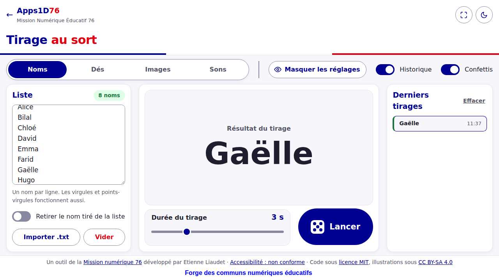
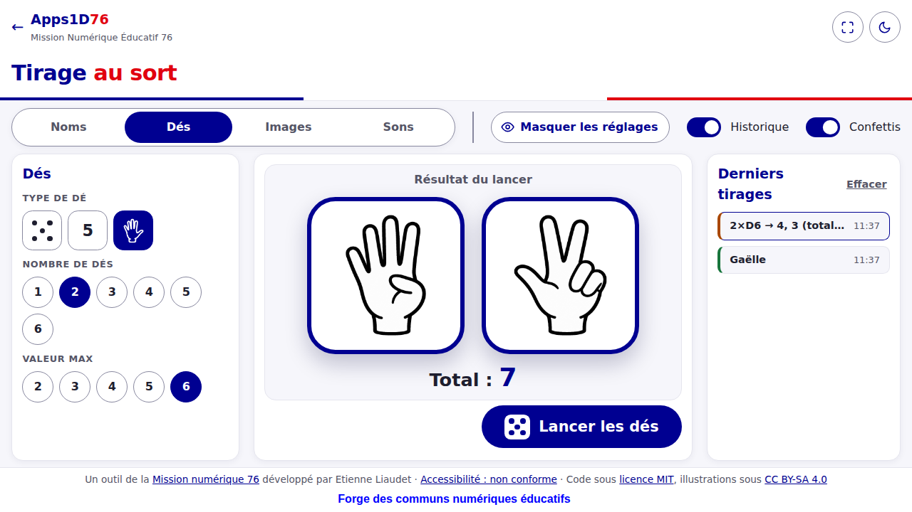

# Multi-Tirages

## Description

**Multi-Tirages** est une application web de tirage au sort pour la classe. Elle réunit quatre tirages dans une seule page, un onglet par type :

- **Noms** : une liste collée ou importée, un tirage animé, un historique et des confettis ;
- **Dés** : 1 à 6 dés, en style Points, Chiffres ou Doigts, avec une valeur maximale réglable ;
- **Images** : une image tirée dans un dossier, avec une animation en carrousel ;
- **Sons** : les sons d'un dossier mélangés puis écoutés un à un, pour faire deviner des bruits.

**Public visé** : enseignants et élèves, en classe, à tous les niveaux et dans toutes les disciplines. L'interface est pensée pour le tableau blanc interactif (TBI), la tablette et l'ordinateur ; elle fonctionne aussi sur téléphone.

C'est une application statique : un simple dossier de fichiers HTML, CSS et JavaScript. Elle n'a pas de serveur, pas de compte, pas de dépendance à installer.

**Respect de la vie privée** : les noms, images et sons restent sur l'appareil. Rien n'est envoyé en ligne. Les réglages et la liste de noms sont mémorisés dans le navigateur de l'appareil (stockage local) ; le bouton « Vider » les efface.

## Visuels

| Onglet Noms | Onglet Dés (style Doigts) |
|---|---|
|  |  |

La démo en ligne est disponible une fois GitLab Pages activé : l'adresse figure dans *Déploiement > Pages* du projet.

## Installation

**Prérequis** : un navigateur récent (Chrome ou Edge 84 et plus, Firefox 75 et plus, Safari ou iPadOS 14.5 et plus). Pour travailler en local, un serveur de fichiers statiques, par exemple Python 3.

Aucune installation de dépendance ni de compilation n'est nécessaire :

```bash
git clone <adresse-du-dépôt>
cd Multi-Tirages
python3 -m http.server 8080
```

Ouvrez ensuite `http://localhost:8080` dans le navigateur.

**Publication** : le fichier `.gitlab-ci.yml` publie le site sur GitLab Pages à chaque modification de la branche principale. Après le premier pipeline, allez dans *Déploiement > Pages* et décochez « Utiliser un domaine unique » si vous voulez une adresse stable.

**Dépendances externes** (l'application fonctionne sans elles, avec un rendu un peu différent) :

- la police Marianne, chargée depuis `cdn.jsdelivr.net` (voir `css/outil.css`) ; sans réseau, une police du système la remplace ;
- le logo du cartouche de la Forge, chargé depuis `docs.forge.apps.education.fr` ;

## Utilisation

**Le plus simple : tirer un nom.**

1. Dans l'onglet **Noms**, collez une liste (un nom par ligne), ou importez un fichier `.txt` ou `.csv`.
2. Cliquez sur **Lancer** (ou appuyez sur `Espace` ou `Entrée`).
3. L'option « Retirer le nom tiré de la liste » évite les doublons ; l'historique garde la trace des derniers tirages.

Autres raccourcis : `F` pour le plein écran, `Échap` pour en sortir. Le bouton « Masquer les réglages » laisse toute la place au résultat.

### Onglet Dés

Choisissez le type de dé (points, chiffres ou doigts), le nombre de dés et la valeur maximale, puis « Lancer les dés ». Le total s'affiche sous les dés.

### Onglet Images

Choisissez un dossier (« Choisir un dossier ») ou plusieurs fichiers (« Choisir des images »), puis « Lancer » : les images défilent et s'arrêtent sur l'image tirée, affichée en grand avec son nom.

| Prise en charge | Formats |
|---|---|
| Tous les navigateurs | JPG / JPEG, PNG, GIF, WebP, SVG, BMP, ICO |
| Selon le navigateur | AVIF (navigateurs récents) · HEIC / HEIF et TIFF (Safari seulement) |
| Non pris en charge | Photos RAW (CR2, NEF…), PSD, PDF, vidéos |

- Formats conseillés : **JPG ou PNG**, au moins 400 px de côté. Les sous-dossiers sont inclus ; 300 images au maximum.
- Un fichier illisible est listé dans un compte rendu avec la raison, et écarté du tirage.
- La légende est le nom du fichier sans l'extension, `_` remplacé par une espace : `chat_noir.jpg` donne « chat noir ». Elle peut être masquée.
- La croix rouge d'une miniature retire cette image du tirage. « Réinitialiser » remet toutes les images en jeu.
- Sur iPad et iPhone, le choix d'un dossier n'est pas possible : utilisez « Choisir des images ».
- Les images ne sont pas conservées : il faut les rechoisir après un rechargement de la page.

### Onglet Sons

1. Choisissez un dossier ou plusieurs fichiers : les sons sont **mélangés au hasard**.
2. « Écouter le son » lance le son en cours ; pendant la lecture, le bouton met en pause puis reprend ; une fois le son fini, « Réécouter » le rejoue.
3. « Son suivant » et « Son précédent » parcourent le tirage. La barre du bas montre la progression ; un clic sur une case y va directement.
4. Décochez « Afficher le nom du son » pour faire deviner le bruit.
5. « Remélanger » refait un nouvel ordre ; « Vider » retire les sons.
6. « Défilement automatique » enchaîne les sons seuls, avec une pause de 1 à 30 s entre deux.

Clavier : `Espace` = écouter ou pause, `←` `→` = son précédent ou suivant.

| Prise en charge | Formats |
|---|---|
| Tous les navigateurs | MP3, WAV, M4A / AAC |
| Selon le navigateur | OGG, OPUS, WEBM (pas sur les anciens iPad et iPhone) · FLAC (navigateurs récents) |
| Non pris en charge | WMA, MIDI, AIFF (hors Safari), vidéos |

Format conseillé : **MP3**. 200 sons au maximum. Sur iPad et iPhone, utilisez « Choisir des sons ».

## Structure du dépôt

```
index.html                      Page principale
accessibilite.html              Déclaration d'accessibilité
css/outil.css                   Interface commune (thème clair et sombre, composants)
css/style.css                   Styles propres à l'outil
scripts/outil.js                Interface commune : thème, réglages partagés
scripts/randomizer.js           Logique de l'application
assets/dice-hands/              Illustrations des dés « Doigts » (voir son README)
images/                         Captures d'écran du README
.gitlab-ci.yml                  Publication sur GitLab Pages
LICENSE                         Licence MIT du code
CHANGELOG.md, CONTRIBUTING.md   Journal des versions, guide de contribution
```

## Support

Pour signaler un problème ou poser une question, ouvrez un ticket dans la section **Tickets** du projet sur la Forge. Ne joignez jamais de vrais noms d'élèves ni de données personnelles.

## Contribution

Le projet est ouvert aux contributions. Les règles, le lancement en local et la marche à suivre pour une merge request sont dans [`CONTRIBUTING.md`](CONTRIBUTING.md).

Il n'y a pas de suite de tests automatisée : vérifiez vos changements à la main dans les quatre onglets, sur grand écran et sur écran de téléphone.

**Problèmes connus**

- Safari et Firefox n'ont pas été testés sur de vrais appareils ; seul Chrome (émulation de plusieurs écrans) l'a été.
- Les vieux iPad bloqués en iOS 12 ne sont pas pris en charge.
- Accessibilité : l'outil suit les règles du RGAA sans avoir fait l'objet d'un audit ; il est déclaré « non conforme » (voir `accessibilite.html`).

## Auteurs et remerciements

- **Etienne Liaudet** : conception, code et illustrations. Un outil de la [Mission numérique 76](https://prim76.ac-normandie.fr/numerique).
- Les dessins de mains ont été retravaillés (cadrage, taille et épaisseur de trait uniformisés) avec l'aide d'un outil d'intelligence artificielle.

**Ressources tierces**

| Ressource | Auteur | Licence | Usage |
|---|---|---|---|
| [Feather Icons](https://github.com/feathericons/feather) (tracés des icônes plein écran) | Cole Bemis | MIT | Icônes inline dans `index.html` et `css/style.css` |
| Police [Marianne](https://github.com/GouvernementFR/dsfr) (système de design de l'État, DSFR) | Direction interministérielle du numérique | Etalab 2.0, avec des conditions d'usage propres au DSFR | Chargée depuis un CDN par `css/outil.css` |

Attention : les conditions d'usage du DSFR limitent son emploi à l'administration et à ses services. Vérifiez-les avant de réutiliser la police Marianne ou la bande tricolore dans un autre contexte ; vous pouvez les remplacer en modifiant `css/outil.css`.

## Licence

Ce projet est mixte :

- **Code** (HTML, CSS, JavaScript) : licence **MIT**, voir [`LICENSE`](LICENSE).
- **Illustrations** (dessins de mains et icônes, dans `assets/` et `icon.png`) : licence **Creative Commons BY-SA 4.0**, voir [`assets/dice-hands/LICENCE.md`](assets/dice-hands/LICENCE.md).

Les deux licences sont rappelées dans le pied de page de l'application.

## Statut du projet

**Actif.** Les contributions et les co-mainteneurs sont les bienvenus.
